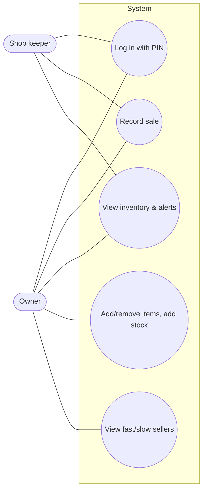
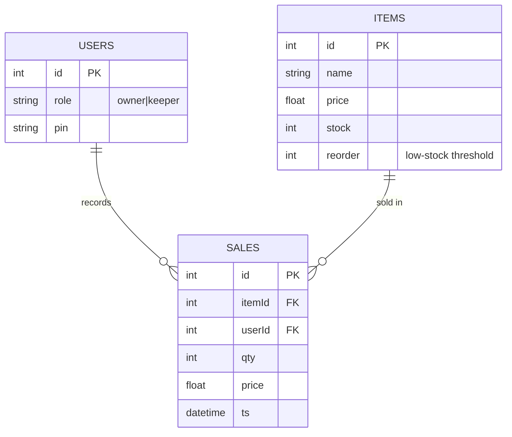

# Tindahan Stock Tracker (for Liza's sari-sari store)

Mobile-friendly installable web app (PWA). Works offline; data is stored on the phone.

## Run
```
cd liza-stock-tracker
python -m http.server 8080
```
Open `http://<your-PC-IP>:8080` on the phone (same Wi-Fi) → browser menu → **Add to Home screen**.
(Or simply open `index.html` on a PC.) Default PINs: owner `1234`, shop keeper `0000` — change them in the Stock tab.

## Features → problems solved
| Feature | Problem fixed |
|---|---|
| Access through a mobile app (PWA) | Pen-and-paper only (Sep 4) |
| Each sale is recorded immediately | Pen-and-paper sales (Sep 4) |
| Stock auto-decreases after each sale | Relying on memory (Sep 4) |
| Low-stock alerts (per-item threshold) | Memory-based restocking (Sep 4) |
| View inventory; owner adds/removes items and adds stock | Tracking stock (Sep 4) |
| Fast / normal / slow tags, units sold, estimated days left | Doesn't know what sells fast, over-buys (Sep 6) |

## Roles
- **Owner**: sell, add/remove items, add stock, change PINs, view reports.
- **Shop keeper**: view inventory, record sales (this auto-updates stock), view reports; cannot manage stock. *(Assumption: the keeper must be able to record sales.)*

Out of scope (per document): customer-facing stock view, buying stock in-app.

## Use case diagram


## ER diagram


## Part 5.1 (for the document)
Dev tool: Google Antigravity | Claude Sonnet 5.5 Medium · Language: JavaScript (HTML/CSS) · Database: browser localStorage (users, items, sales) · Code: this folder.

## Limitations
Data lives on one device (clear browser data = data loss); PINs are a simple access check, not strong security. A cloud backend (e.g. Firebase) is the natural next step.

## Sharing data across devices (Firebase)
1. console.firebase.google.com -> create project -> Build -> Firestore Database -> Create (test mode).
2. Project settings -> Add web app -> copy `firebaseConfig` into `firebase-config.js`.
3. Commit and push; every device now shares one inventory in real time. Without a config the app stores data locally only.

